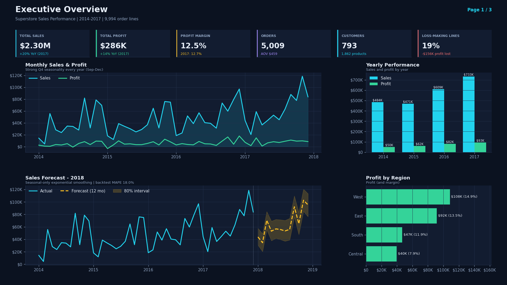
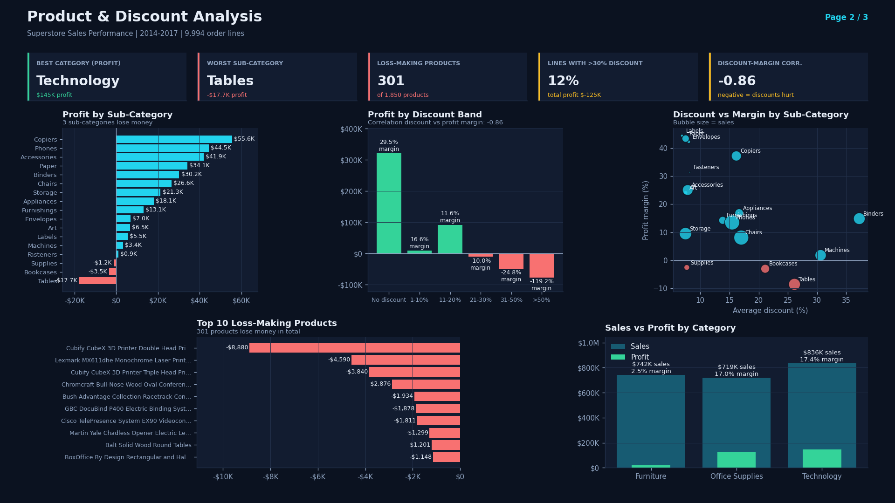
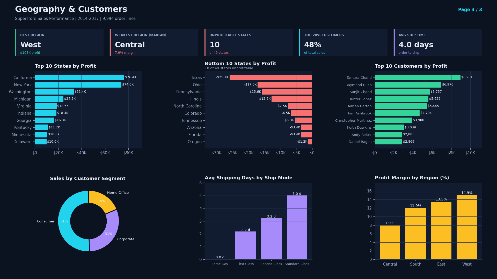

# Superstore Sales Performance Analysis

End-to-end sales analytics project on the Superstore dataset: **data cleaning, KPI analysis, loss-making product analysis, discount-impact analysis, 12-month sales forecast, SQL queries and a 3-page dashboard**, ending with data-backed business recommendations.

> **Tools:** Python (pandas, matplotlib, statsmodels) · SQL (SQLite / PostgreSQL-compatible) · Excel-ready CSV outputs
> **Data:** 9,994 order lines · 21 columns · Jan 2014 – Dec 2017 · United States

## Business questions
1. How are sales, profit and margin trending, and what will 2018 look like?
2. Which products and sub-categories lose money?
3. How much do discounts really cost the business?
4. Which regions and states drag profitability down?
5. What should management change first?

## Headline results

| Metric | Value |
|---|---|
| Total sales | **$2.30M** |
| Total profit | **$286.4K** (12.5% margin) |
| Orders / customers / products | 5,009 / 793 / 1,862 |
| Sales growth 2016 → 2017 | +20.4% |
| Order lines that lose money | **18.7%** (−$156K) |
| 2018 sales forecast (12 months) | **$779K** (+6.2% vs 2017) |

## Key findings
- **Discounting is the biggest profit leak.** Lines with no discount earn a **29.5%** margin; lines discounted **above 20%** lose money (~92% of them are loss-making). The 1,393 lines above 20% discount lost **$135K combined**. Correlation between discount and margin: **−0.86**.
- **Furniture is the weak spot.** $742K sales (largest by revenue after Technology) but only **2.5% margin**. **Tables (−$17.7K)**, **Bookcases (−$3.5K)** and **Supplies (−$1.2K)** are loss-making sub-categories.
- **301 of 1,850 products lose money** (−$77K in total). The top losers are 3D printers and laser printers sold at 40–53% average discounts.
- **Central region has the lowest margin (7.9%)** and the deepest average discount (24%). **10 of 49 states are unprofitable**; Texas, Ohio, Pennsylvania and Illinois alone lose **$70.9K**.
- **Strong Q4 seasonality** every year; the top 20% of customers generate **48%** of sales.

Full write-up with numbers and recommendations: [`docs/insights_and_recommendations.md`](docs/insights_and_recommendations.md)

## Dashboard
**Page 1 – Executive overview**


**Page 2 – Product & discount analysis**


**Page 3 – Geography & customers**



Four models were compared on a 12-month hold-out (train 2014-2016, test 2017):

| Model | MAPE |
|---|---|
| **Seasonal exponential smoothing (selected)** | **18.0%** |
| Holt-Winters, damped trend | 18.5% |
| Holt-Winters, additive trend | 22.6% |
| Seasonal naive (same month last year) | 24.5% |

The selected model was refit on all 48 months. Output with 80% intervals: [`reports/sales_forecast_2018.csv`](reports/sales_forecast_2018.csv). *Limitation: only 4 years of history, so intervals are wide and the forecast should be read as a planning range, not a promise.*

## Data cleaning summary

| Check | Result |
|---|---|
| Rows / columns loaded | 9,994 / 21 (file encoding Windows-1252) |
| Missing values | 0 found |
| Duplicate rows / duplicate Row ID | 0 found |
| Date parsing | `M/D/YYYY` (US format) → ISO `YYYY-MM-DD`; no ship date before order date |
| Text fields | Trimmed and whitespace-normalised (Customer, Product, City, State) |
| Postal code | Stored as text, leading zeros restored (e.g. 6824 → 06824) |
| Engineered columns | `Ship Days`, `Year`, `Month Start`, `Profit Margin`, `Is Loss`, `Discount Band` |
| Reconciliation | Total sales before and after cleaning = **$2,297,200.86** ✔ |

## Project structure
```
├── data/
│   ├── raw/Sample - Superstore.csv      # original Kaggle file
│   └── processed/superstore_clean.csv   # cleaned, analysis-ready
├── src/analysis.py                      # full pipeline (clean → analyse → forecast → charts)
├── sql/analysis_queries.sql             # 12 business queries (window functions, CTEs)
├── reports/                             # summary tables (CSV) + metrics.json + forecast
├── images/                              # 10 charts + 3 dashboard pages
├── docs/
│   ├── insights_and_recommendations.md
│   └── powerbi_build_guide.md           # optional: rebuild the dashboard in Power BI (DAX included)
├── requirements.txt
└── README.md
```

## How to reproduce
```bash
git clone https://github.com/<your-username>/powerbi-sales-performance-dashboard.git
cd powerbi-sales-performance-dashboard
pip install -r requirements.txt
python src/analysis.py
```
This regenerates the cleaned data, all report tables and every image.

To run the SQL, load `data/processed/superstore_clean.csv` into a table named `orders` (SQLite, PostgreSQL, etc.) and execute `sql/analysis_queries.sql`.

## Data source
Superstore Sales Dataset by vivek468 on Kaggle: https://www.kaggle.com/datasets/vivek468/superstore-dataset-final
Please check the dataset's license on the Kaggle page before reuse. The data is a sample/fictional retail dataset used for learning and portfolio work.

## Author
**Md. Saidul Islam** · Frontend Developer (Next.js & React) · [Portfolio](https://saidul-dev-mern.vercel.app) · saidulhimuu@gmail.com
